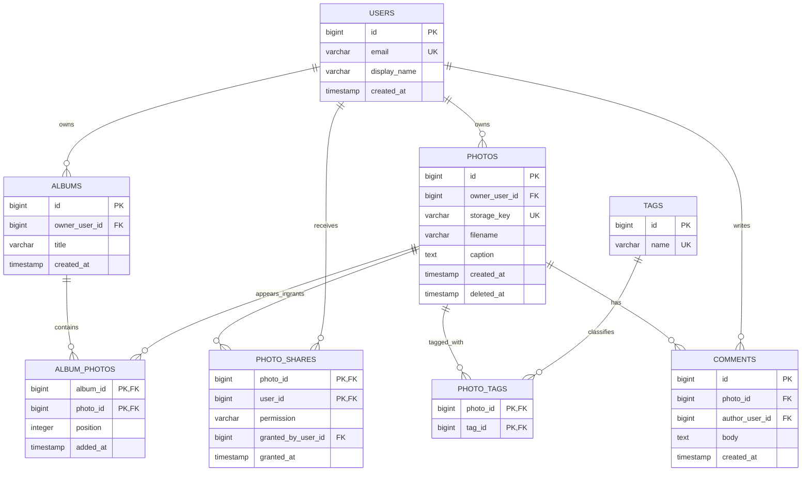
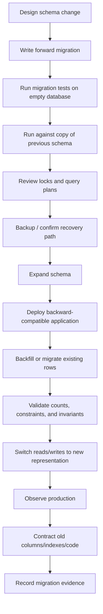

> **Type:** Informative research synthesis (not a binding contract)
> **Origin:** Completed Deep Research report, October 23, 2026.
> **Provenance:** Full text preserved from the original report's text export; proprietary inline citation identifiers are not portable outside the research interface. Consult [primary source links](../references/primary-sources.md) before relying on externally sourced claims.
> **Scope:** Relational web-site, multiuser platform, and web-application architecture.

# DBbasic Research Report: Relational Database Architecture for Single-Website, Multiuser Platforms and Web Applications

## Executive summary

The strongest foundation for a `DBbasic` system is **relational integrity first, engine-specific optimization second**. For normal web applications, the database should begin as a normalized transactional model, generally targeting **Third Normal Form or Boyce-Codd Normal Form for the authoritative data model**, with higher normal forms applied when the data actually exhibits independent multivalued or join dependencies. Codd's foundational relational work established normalization as part of the relational model; later work by Fagin formalized fourth normal form around multivalued dependencies, while Kent's widely cited treatment presents the progression through the first five normal forms as practical record-design guidance. For a website such as PhotoSync, that means users, photos, albums, permissions, tags, comments, and other independent facts should normally be represented as distinct relations rather than embedded repeatedly into large records. Many-to-many relationships should be represented explicitly by **junction tables** with foreign keys and uniqueness or composite-primary-key constraints. Foreign keys should be enforced by the database rather than treated merely as application conventions. PostgreSQL, MySQL/InnoDB, and SQLite all support these integrity mechanisms, although SQLite requires foreign-key enforcement to be enabled for each connection and the engines differ in indexing and referential-action details. `DBbasic` should make a strong distinction between **relationships, automation, and search**:

- Foreign keys and junction tables describe relationships.
- Constraints protect invariants.
- Transactions protect multi-statement invariants.
- Indexes make access paths efficient.
- Triggers automate database-side reactions.
- Stored procedures package database-side operations where an engine supports them.
- Full-text indexes support linguistic/text retrieval.
- Tags/keywords that represent structured relationships belong in tables, not comma-separated columns.

That separation prevents a frequent anti-pattern: using triggers, JSON, delimited strings, or application code to compensate for a poorly modeled relational schema.

For portable web applications, `DBbasic` should recommend that **core business behavior remain explicit in application/service code and ordinary transactions unless the database is uniquely positioned to guarantee the behavior**. Triggers are valuable for narrowly scoped auditing, invariant maintenance, or derived values that must remain correct regardless of which application performs a write. They become dangerous when they hide substantial workflows, call chains, authorization behavior, or cross-table business logic. SQLite, PostgreSQL, and MySQL all implement triggers differently; PostgreSQL and MySQL additionally offer server-side procedures/functions, while SQLite does not provide an equivalent SQL stored-procedure facility. SQLite itself recommends caution with `BEFORE` triggers and generally favors `AFTER` triggers when either could accomplish the task. Indexing should be **query-driven rather than column-driven**. Primary and unique keys require indexes; foreign-key/join columns commonly need indexes; composite indexes should reflect actual predicate, join, ordering, and grouping patterns. PostgreSQL and SQLite support predicate/partial indexes; PostgreSQL supports explicit covering payload columns through `INCLUDE`; SQLite can obtain covering behavior when all needed values exist in an index; MySQL/InnoDB also benefits from covering secondary indexes and follows leftmost-prefix semantics for multicolumn indexes. Every additional index has write, storage, cache, and maintenance costs. For concurrency, a critical `DBbasic` rule should be: **transactions must be short, explicit, retryable where the engine requires it, and organized around business invariants rather than HTTP request lifetime**. PostgreSQL uses MVCC and defaults to Read Committed; MySQL/InnoDB defaults to Repeatable Read; SQLite provides serializable transactions but permits only one simultaneous writer to a database file, with WAL mode allowing readers to continue while that writer operates. These differences are significant enough that application behavior must not rely on default isolation semantics being portable. Academic work on isolation also demonstrates why the traditional ANSI labels do not completely characterize every implementation or anomaly. For **a single application instance or modest single-host website**, SQLite can be an excellent production database when the write-concurrency profile fits its architecture. SQLite's own guidance describes it as suitable for many low-to-medium-traffic websites but recommends a client/server engine when there are many concurrent writers, multiple application servers, or network-separated database access. WAL improves concurrency but still permits only one writer and is intended for processes on the same host rather than access through a network filesystem. Accordingly, `DBbasic` should **not teach “SQLite is for development, PostgreSQL/MySQL are for production.”** That rule is too crude. A better decision rule is:

> **Use SQLite when an embedded, single-host database with limited simultaneous write concurrency fits the system. Use a client/server engine when the architecture requires multiple application hosts, substantial concurrent writes, centralized role/connection controls, high-availability infrastructure, replication/PITR operations, or independent database scaling.**

That distinction follows SQLite's documented architecture rather than an arbitrary user-count threshold. Database migrations should be immutable, version-controlled deployment artifacts. Production migrations should use an **expand → migrate/backfill → contract** workflow where a schema change cannot safely be made atomically with an application deployment. PostgreSQL DDL may acquire strong locks, and `CREATE INDEX CONCURRENTLY` has special transaction restrictions; MySQL DDL frequently causes implicit commits despite its atomic-DDL facilities, although InnoDB offers online DDL for many changes; SQLite provides transactional schema operations and `PRAGMA user_version`, but complicated schema transformations may require table reconstruction. Security should treat the database as its own trust boundary. Runtime applications should not connect as database owners, root, or superusers. Migration credentials and application credentials should be separate. SQL values should be parameterized; dynamic identifiers should be allow-listed rather than concatenated blindly. OWASP explicitly recommends parameterized queries and least-privilege database accounts, as well as restricted network exposure, TLS for client/server traffic, and managed secret storage. Backups should be designed from **RPO and RTO**, not merely from “we have a backup job.” SQLite provides an online backup API; PostgreSQL supports logical dumps, physical backup, and continuous WAL archiving/PITR; MySQL supports dumps and binary-log-based point-in-time recovery. Backups must be restored and tested periodically because successful backup creation alone does not demonstrate recoverability. Google Cloud's disaster-recovery guidance similarly frames architecture around recovery-point and recovery-time objectives. Finally, `DBbasic` fits naturally into SABOS Lib as its own governed knowledge system. The repository already defines `*basic` systems as versioned bodies of knowledge that distinguish contracts, positions, standards, research, vendor guidance, examples, and subject artifacts; its standard shape provides `README.md`, `AGENTS.md`, `CHANGELOG.md`, `docs/`, optional examples, and genuine subject artifacts rather than empty structural symmetry. fileciteturn2file0L2-L2 fileciteturn3file0L2-L2

**Recommended DBbasic practitioner position:** normalize authoritative data; enforce integrity in the database; keep transactions explicit and short; design indexes from demonstrated workloads; prefer portable SQL for core behavior; isolate engine-specific features behind clearly documented profiles; use triggers sparingly; treat migrations, backups, restore testing, monitoring, and security as parts of database design rather than operations added later.

## Relational modeling and schema design

**Normalization should establish the canonical model before performance tuning.** Normalization exists to keep independent facts independent, reducing contradictory copies and update anomalies. The first several normal forms progressively constrain how attributes depend on keys; fourth normal form addresses independent multivalued dependencies. Codd, Fagin, and Kent provide the theoretical basis for this approach. | Level | Practical DBbasic interpretation | Typical violation |
|---|---|---|
| **First Normal Form** | Represent repeating facts as rows rather than repeating column groups or comma-separated collections. | `photo.tags = 'family,trip,sunset'` when tags are relational entities. |
| **Second Normal Form** | A non-key fact should depend on the whole candidate key, not only part of a composite key. | `album_photos(album_id, photo_id, album_name)` where `album_name` depends only on `album_id`. |
| **Third Normal Form** | Non-key facts should describe the key rather than other non-key facts. | Repeating `owner_email` on every photo when it is determined by `owner_user_id`. |
| **Boyce-Codd Normal Form** | Every determinant should be a candidate key/superkey. | A less-obvious functional dependency allows one non-key determinant to determine another attribute. |
| **Fourth Normal Form** | Keep independent many-valued facts in separate relations. | Combining a user's independent roles and notification channels into all possible role/channel combinations. |
| **Fifth Normal Form** | Decompose relationships when redundancy arises only from more complex join dependencies. Usually uncommon in ordinary website schemas. | A ternary relationship whose valid tuples can be reconstructed without redundancy from several smaller relationships. |

These levels are design tools, not scores. A web application does not become “better” merely by decomposing everything into the maximum number of tables. The practical target for an OLTP core should ordinarily be **3NF/BCNF**, moving to 4NF where independent multivalued relationships genuinely exist. Fifth-normal-form decomposition should be driven by an actual join dependency, not architectural aesthetics. **Denormalization should require evidence.** A duplicated column, summary table, cached count, materialized result, or search document can be legitimate, but `DBbasic` should require four things to be documented: the authoritative source, the measured reason for duplication, how consistency is maintained, and how the derived data can be rebuilt. This preserves the relational source of truth while allowing deliberate read optimization.

A good position is:

> **Normalize by default; denormalize from measurements, not predictions.**

The first optimization should generally be better indexing, better predicates, better query structure, reduced result volume, or an appropriate materialized/read model—not uncontrolled duplication of authoritative facts.

**Structured keywords and tags should be relations.** A PhotoSync-style system should not store reusable tags as comma-separated text:

```sql
-- Anti-pattern
photos (
    id,
    owner_id,
    filename,
    tags_text -- "family,vacation,texas"
);
```

Instead:

```sql
CREATE TABLE tags (
    id          BIGINT PRIMARY KEY,
    name        VARCHAR(100) NOT NULL UNIQUE
);

CREATE TABLE photo_tags (
    photo_id    BIGINT NOT NULL,
    tag_id      BIGINT NOT NULL,

    PRIMARY KEY (photo_id, tag_id),

    FOREIGN KEY (photo_id)
        REFERENCES photos(id)
        ON DELETE CASCADE,

    FOREIGN KEY (tag_id)
        REFERENCES tags(id)
        ON DELETE CASCADE
);
```

This makes tag membership constrainable, indexable, joinable, deduplicated, and independently maintainable through ordinary relational mechanisms supported by all three engines. Free-form captions or descriptions are different: those are textual attributes and are candidates for full-text indexing rather than normalization into “keyword” rows.

**Every durable entity should have a declared primary key.** MySQL's InnoDB documentation explicitly recommends defining one for each table and uses it as the clustered index; PostgreSQL primary keys imply uniqueness and non-nullness and create a unique B-tree index. SQLite likewise gives special storage semantics to an `INTEGER PRIMARY KEY`. `DBbasic` should not prescribe one universal key format. Numeric surrogate keys, UUIDs, and stable natural keys each have legitimate uses. It should prescribe the following instead:

> A surrogate key does not replace business uniqueness.

For example, a `users.id` surrogate key may be appropriate while a normalized login identifier or external-provider identifier still requires a `UNIQUE` constraint when the business rule says duplicates cannot exist.

**Foreign keys should express actual ownership and dependency.** Do not add `ON DELETE CASCADE` reflexively. It is appropriate for truly subordinate objects—such as `photo_tags` rows that have no meaning once the photo is gone. For records with independent legal, billing, audit, or historical significance, restrictive deletion or an explicit application workflow is safer. All three engines support referential actions, although implementation details differ. A PhotoSync-like relational core might look like this:



A many-to-many table should ordinarily have either **a composite primary key containing its participating foreign keys** or its own surrogate key plus a `UNIQUE` constraint over the relationship. The latter is useful when the relationship itself has an independent identity or other tables must reference it. A surrogate ID without a uniqueness constraint on `(album_id, photo_id)` would accidentally permit duplicate memberships.

A portable junction-table template is:

```sql
CREATE TABLE photo_shares (
    photo_id         BIGINT NOT NULL,
    user_id          BIGINT NOT NULL,
    granted_by_id    BIGINT NOT NULL,
    permission       VARCHAR(16) NOT NULL,
    granted_at       TIMESTAMP NOT NULL,

    PRIMARY KEY (photo_id, user_id),

    FOREIGN KEY (photo_id)
        REFERENCES photos(id)
        ON DELETE CASCADE,

    FOREIGN KEY (user_id)
        REFERENCES users(id)
        ON DELETE CASCADE,

    FOREIGN KEY (granted_by_id)
        REFERENCES users(id)
);

CREATE INDEX idx_photo_shares_user
    ON photo_shares(user_id, photo_id);
```

The reverse index is important because the composite primary key beginning with `photo_id` is not generally equivalent to an efficient lookup by `user_id`. Multicolumn B-tree use is sensitive to column order in PostgreSQL and MySQL, and SQLite's query planner likewise evaluates available indexes according to query predicates. **Common schema anti-patterns** that should appear explicitly in DBbasic include entity data encoded as JSON merely to avoid tables; comma-separated foreign keys; EAV schemas for ordinary fixed attributes; duplicated user information in every content table; nullable foreign keys whose semantics are undefined; polymorphic references such as `(object_type, object_id)` with no enforceable foreign key; surrogate keys without corresponding business uniqueness; and `ON DELETE CASCADE` chains whose destructive reach has never been mapped.

SQLite deserves one additional rule: **enable foreign keys on every application connection** rather than assuming they are enabled. SQLite documents that foreign-key enforcement is connection-controlled and applications should explicitly enable it. Index child foreign-key columns that participate in parent-delete/update checks or ordinary joins. ## Integrity, triggers, procedures, audit, and schema evolution

**Constraints should do the work that constraints can do.** `NOT NULL`, `UNIQUE`, `CHECK`, primary keys, and foreign keys are easier to inspect and port than equivalent trigger logic. A trigger should not be the first choice for preventing duplicate emails, enforcing a required relationship, or restricting a value to a finite domain when a declarative constraint can express the rule.

The preferred hierarchy for DBbasic should be:

```text
Declarative constraint
        ↓
Transaction / atomic SQL operation
        ↓
Application service rule
        ↓
Trigger or stored routine
        ↓
Engine-specific mechanism
```

The hierarchy is not about power; it is about **visibility, portability, and verifiability**.

**Triggers are appropriate when a database-side reaction must occur regardless of which writer changes the row.** Good candidates include narrowly designed audit capture, maintenance of a database-owned derived value, compatibility views, or enforcing an invariant that cannot be expressed declaratively. All three target engines support triggers, but their semantics are not portable enough for DBbasic to treat trigger SQL as a universal artifact. SQLite supports `BEFORE`, `AFTER`, and `INSTEAD OF` behavior and warns about ambiguous results from some `BEFORE` trigger patterns, recommending `AFTER` triggers where practical. PostgreSQL triggers execute trigger functions and support both row- and statement-level behavior. MySQL triggers execute per row and expose `OLD` and `NEW` values. Example of a deliberately simple audit trigger concept:

```sql
-- PostgreSQL-flavored example; not portable SQL.
CREATE FUNCTION audit_photo_change()
RETURNS trigger
LANGUAGE plpgsql
AS $$
BEGIN
    INSERT INTO audit_events (
        entity_type,
        entity_id,
        action,
        occurred_at
    )
    VALUES (
        'photo',
        COALESCE(NEW.id, OLD.id),
        TG_OP,
        CURRENT_TIMESTAMP
    );

    RETURN COALESCE(NEW, OLD);
END;
$$;
```

The key principle is more important than the syntax: the trigger writes an audit event; it does **not** send email, calculate authorization, modify six unrelated domains, issue HTTP requests, or initiate a hidden workflow.

**Trigger anti-patterns** should be binding DBbasic guidance:

> Do not use triggers as an invisible application framework.

Long chains of triggers make write behavior difficult to reason about and vary substantially across engines. MySQL additionally documents that cascaded foreign-key actions do not activate triggers, illustrating why assumptions about indirect trigger execution are dangerous. A trigger should therefore have documented:

```text
event
table
timing
rows affected
tables it may modify
recursion/cascade implications
failure semantics
migration dependency
test coverage
engine compatibility
```

**Stored procedures should be optional, engine-specific architecture.** PostgreSQL has first-class procedures invoked with `CALL` and also supports SQL/PL functions; MySQL has stored procedures and functions as stored programs. SQLite does not provide a directly equivalent SQL stored-procedure system, so placing core application behavior in procedures substantially lowers SQLite portability. DBbasic should therefore adopt:

> **Stored procedures MAY be used when server-side encapsulation has a demonstrated operational or integrity advantage. A portable profile MUST NOT depend on them.**

Strong stored-procedure candidates include carefully controlled bulk operations, server-side administrative routines, or a database API deliberately designed around procedures. Weak candidates are ordinary CRUD operations that become harder to test, version, or migrate simply because they are hidden behind `CALL`.

**Audit trails and soft deletion are different concepts.** A soft-delete field records lifecycle state; it does not establish who changed a row, what changed, why it changed, or which request performed the operation. Security/audit logging should preserve sufficient event context and should be protected from unauthorized modification. OWASP specifically recommends application/security event logging in addition to infrastructure/database logs and advises against recording sensitive credentials or session secrets. A useful portable audit schema is:

```sql
CREATE TABLE audit_events (
    id              BIGINT PRIMARY KEY,
    occurred_at     TIMESTAMP NOT NULL,

    actor_user_id   BIGINT,
    action          VARCHAR(64) NOT NULL,

    entity_type     VARCHAR(64) NOT NULL,
    entity_id       VARCHAR(128),

    request_id      VARCHAR(128),
    source          VARCHAR(64),

    old_values      TEXT,
    new_values      TEXT
);
```

Actual JSON types can replace `TEXT` in engine profiles where useful. Audit records should avoid passwords, authentication tokens, encryption keys, and unnecessary sensitive values. OWASP's secrets and logging guidance supports keeping secrets out of general application storage/logging and managing them through explicit lifecycle controls. For soft deletion:

```sql
UPDATE photos
SET deleted_at = CURRENT_TIMESTAMP
WHERE id = ?;
```

DBbasic should require answers to several questions before approving soft delete:

- Does “deleted” mean recoverable, hidden, legally retained, or awaiting asynchronous purge?
- Should child records remain visible?
- Can a soft-deleted value be reused by another row?
- When does hard deletion occur?
- Do backups and search indexes retain the object?
- Is the data subject to a retention or erasure requirement?

For engines supporting partial unique indexes, active-row uniqueness can be cleanly expressed:

```sql
-- PostgreSQL or SQLite concept.
CREATE UNIQUE INDEX uq_active_username
ON users(username)
WHERE deleted_at IS NULL;
```

Both PostgreSQL and SQLite document predicate/partial indexes. MySQL does not have the same predicate-index form, so an engine-specific generated-column/index strategy may be required for some conditional-index designs; MySQL documents indexing generated columns and optimizer use of those indexes. **Migrations should be treated as production code.** Every database change should have a stable migration identifier, be source-controlled, run exactly once, and leave enough metadata to determine which schema version is installed. Existing production migration files should normally be immutable after release; corrections should be subsequent migrations rather than silent edits.

A migration record can be portable:

```sql
CREATE TABLE schema_migrations (
    version         VARCHAR(100) PRIMARY KEY,
    applied_at      TIMESTAMP NOT NULL,
    checksum        VARCHAR(128) NOT NULL,
    description     VARCHAR(255) NOT NULL
);
```

SQLite additionally exposes `PRAGMA user_version`, specifically reserved for application use, making it useful as a lightweight SQLite profile mechanism. Production-safe migrations should follow an expand/contract workflow:



An example is replacing `photos.owner_email` with `owner_user_id`. Do not drop `owner_email`, deploy new code, and hope the release is simultaneous. Add the new column, make both versions coexist temporarily, backfill, validate, switch application behavior, then remove the old representation in a later deployment.

The need for staged migrations is partly operational. PostgreSQL documents that many `ALTER TABLE` forms take `ACCESS EXCLUSIVE` locks unless otherwise specified and that `CREATE INDEX CONCURRENTLY` cannot run inside a normal transaction block. MySQL provides online DDL for many InnoDB alterations, but many DDL statements cause implicit commits. SQLite provides transactions around schema changes but has a different `ALTER TABLE` feature set and documents table-reconstruction procedures for changes that are not directly expressible. That means the anti-pattern:

```text
BEGIN;
run every engine's DDL;
if anything fails ROLLBACK;
```

is **not portable**.

DBbasic should explicitly prohibit production reliance on ORM “auto create/update/synchronize schema” modes as the schema-authority mechanism. ORM models may generate proposed migrations, but production schema history should remain reviewable and deterministic.

## Indexing, query planning, transactions, and multiuser concurrency

**Indexes should correspond to access paths.** An index exists to make some reads, joins, uniqueness checks, or ordering operations cheaper in exchange for storage and extra work on writes. Consequently, “index every foreign key and every filterable column” is too simplistic; “never add an index until the site is slow” is equally weak.

A good DBbasic workflow is:

```text
Important query
    ↓
predicate + join + order/group pattern
    ↓
current execution plan
    ↓
candidate index
    ↓
execution plan after index
    ↓
measured latency / rows / I/O
    ↓
retain or remove
```

SQLite explicitly describes query-plan selection as dependent on available indexes; PostgreSQL has multiple index access methods; MySQL/InnoDB distinguishes clustered primary and secondary indexes. **Single-column indexes** are appropriate when the column independently has useful selectivity or is a common join/filter path:

```sql
CREATE INDEX idx_photos_owner
ON photos(owner_user_id);
```

**Composite indexes** should be designed around complete query patterns:

```sql
SELECT id, created_at, storage_key
FROM photos
WHERE owner_user_id = ?
  AND deleted_at IS NULL
ORDER BY created_at DESC
LIMIT 50;
```

Candidate:

```sql
CREATE INDEX idx_photos_owner_deleted_created
ON photos(owner_user_id, deleted_at, created_at);
```

Column order matters. PostgreSQL documents how leading B-tree columns determine efficient search constraints, while MySQL uses the leftmost-prefix rule for multicolumn indexes. The familiar “equality columns first, range column last” rule is therefore a useful starting heuristic, not a substitute for a plan. Sorting requirements, cardinality, skip-scan behavior, engine version, and other predicates can alter the best order.

**Partial indexes** are highly useful where only a subset of rows is queried:

```sql
CREATE INDEX idx_photos_active_owner_created
ON photos(owner_user_id, created_at)
WHERE deleted_at IS NULL;
```

PostgreSQL and SQLite support this directly and note that partial indexes can avoid indexing rows that are not useful to the relevant workload. This is particularly attractive for:

```text
active rows
unprocessed jobs
unread notifications
non-null external identifiers
soft-deleted tables
specific status subsets
```

MySQL should be documented as a separate profile for this pattern rather than pretending the same syntax is portable; generated or functional indexed expressions can solve some equivalent workloads but are not a universal replacement for a predicate index. MySQL documents secondary indexes over generated columns and functional indexing of expressions. **Covering indexes** can satisfy a query from an index without fetching every full table row. PostgreSQL supports payload columns via `INCLUDE` for index-only scans but cautions that extra payload increases index size; MySQL explicitly describes covering indexes as indexes containing all columns retrieved by a query; SQLite's query-planner documentation likewise describes covering access paths. PostgreSQL example:

```sql
CREATE INDEX idx_photo_owner_created
ON photos(owner_user_id, created_at DESC)
INCLUDE (storage_key, filename);
```

Covering is an optimization, not a modeling strategy. Do not turn every index into a copy of the table.

**Use `EXPLAIN` before guessing.** SQLite's `EXPLAIN QUERY PLAN` reports the high-level plan and index use. PostgreSQL `EXPLAIN` exposes the optimizer plan and `EXPLAIN ANALYZE` adds actual execution measurements. MySQL's `EXPLAIN ANALYZE` likewise executes the statement and reports timing and row behavior. Recommended review artifact:

```text
query:
expected cardinality:
actual cardinality:
plan before:
index/change:
plan after:
latency before:
latency after:
write/storage cost:
decision:
```

PostgreSQL's `EXPLAIN ANALYZE` actually executes the query, so side-effecting operations require particular care. Common query/index anti-patterns include:

- adding several overlapping indexes because each query “might” use one;
- indexing very low-selectivity columns alone without evidence;
- using `SELECT *` where a narrow result is sufficient;
- wrapping an indexed column in a function without an appropriate expression index;
- ignoring column order in composite indexes;
- relying on an ORM-generated query without inspecting its actual SQL and plan;
- treating an index scan as automatically superior to a sequential/table scan;
- benchmarking against tiny development fixtures that bear no resemblance to production cardinality.

**Transactions should describe a business unit of work.** Sharing a photo with a user might require inserting a share and recording an audit event. Those operations should either both commit or both fail:

```sql
BEGIN;

INSERT INTO photo_shares (
    photo_id,
    user_id,
    granted_by_id,
    permission,
    granted_at
)
VALUES (?, ?, ?, ?, CURRENT_TIMESTAMP);

INSERT INTO audit_events (
    id,
    occurred_at,
    actor_user_id,
    action,
    entity_type,
    entity_id
)
VALUES (?, CURRENT_TIMESTAMP, ?, 'share.created', 'photo', ?);

COMMIT;
```

The application should not hold that transaction open while sending email, uploading an object to cloud storage, rendering a page, or waiting on an unrelated remote API. Long-lived transactions retain locks/snapshots and increase contention.

**Isolation level names are not sufficiently portable by themselves.** PostgreSQL defaults to Read Committed and implements higher isolation through MVCC, including Serializable isolation that can abort transactions which participate in dangerous serialization patterns. MySQL/InnoDB defaults to Repeatable Read and uses consistent snapshots plus record/gap/next-key locking for relevant locking operations. SQLite serializes transactions and, in WAL mode, provides snapshot-style reads while retaining a single-writer model. The academic literature is important here. Berenson and colleagues' critique of ANSI isolation terminology showed that the conventional phenomena-based definitions do not completely characterize real concurrency-control implementations; Cahill, Röhm, and Fekete later demonstrated serializable snapshot isolation techniques for detecting and preventing serialization anomalies. Therefore DBbasic should specify required **invariants and conflict behavior**, not merely:

```text
Use REPEATABLE READ.
```

For example:

> Two users cannot simultaneously consume the final invitation slot.

That invariant may require a conditional update, row lock, uniqueness constraint, or serializable transaction depending on the operation and engine.

**Application code must expect transaction retries.** Deadlocks, serialization failures, SQLite busy conditions, and optimistic conflicts are normal consequences of concurrency, not necessarily database defects. Retries should occur around a complete idempotent unit of work and use bounded backoff rather than retrying arbitrary individual statements.

**PostgreSQL concurrency:** MVCC is designed so ordinary reads do not block writes and writes do not block ordinary reads merely because they access the same committed versions; explicit row/table locks and write conflicts still matter. **MySQL/InnoDB concurrency:** InnoDB is also multiversion, but its Repeatable Read and locking-read behavior includes record and gap/next-key locking that can produce contention patterns unfamiliar to developers coming from PostgreSQL. **SQLite concurrency:** many simultaneous readers are supported, and WAL permits a writer and readers to overlap, but there is still only one writer at a time. WAL relies on same-host shared coordination and is not designed for a database file accessed over a network filesystem by independent hosts. That yields an important DBbasic decision test:

```text
Are there many users?
        │
        └─ Not enough information.

Are there many overlapping write transactions?
        │
        ├─ No → SQLite may still be excellent.
        │
        └─ Yes
             │
             └─ Do we need multiple app hosts / remote DB / HA?
                    │
                    ├─ No → benchmark SQLite workload.
                    └─ Yes → use a server DB.
```

The number of registered users is not itself a database-engine selection metric. **Concurrent write behavior and deployment topology are.** SQLite's own “appropriate uses” guidance makes essentially this architectural distinction. ## Search, security, resilience, and observability

**Full-text search and relational tags should remain distinct.** A tag such as `wedding` can represent an explicit user-created relationship and belongs naturally in `tags`/`photo_tags`. Searching captions for the word “wedding” is linguistic retrieval and belongs in a full-text index.

SQLite provides **FTS5**, which implements full-text indexing through virtual tables and `MATCH`; external-content FTS5 tables can index content stored elsewhere, but the application must maintain consistency between the source table and index. SQLite example:

```sql
CREATE VIRTUAL TABLE photo_search USING fts5(
    photo_id UNINDEXED,
    filename,
    caption
);

SELECT photo_id
FROM photo_search
WHERE photo_search MATCH 'sunset AND beach';
```

PostgreSQL has a first-class text-search system built around `tsvector` and `tsquery`; a generated `tsvector` column plus a GIN index is a common design, and PostgreSQL's documentation identifies GIN as the preferred text-search index type. ```sql
ALTER TABLE photos
ADD COLUMN search_document tsvector
GENERATED ALWAYS AS (
    to_tsvector(
        'english',
        coalesce(filename, '') || ' ' || coalesce(caption, '')
    )
) STORED;

CREATE INDEX idx_photos_search
ON photos USING GIN(search_document);
```

MySQL/InnoDB supports `FULLTEXT` indexes and `MATCH()` queries, including natural-language and Boolean search modes, with engine-specific token-length and stopword behavior. ```sql
CREATE FULLTEXT INDEX ft_photos
ON photos(filename, caption);

SELECT id
FROM photos
WHERE MATCH(filename, caption)
      AGAINST (? IN BOOLEAN MODE);
```

An **external search engine** should become a separate architectural decision rather than the automatic answer to “we need search.” Start with database-native FTS when it meets ranking, language, volume, and feature requirements. Introduce a separate search system when requirements such as richer ranking models, extensive facets, typo-tolerance behavior, cross-domain search, independent scaling, or search-specific operational needs justify maintaining another data system.

When external search exists, DBbasic should prescribe:

```text
relational database = authority
search index         = derived projection
```

Never make an external search index the only authoritative copy of business records unless the architecture is intentionally no longer relational.

**SQL injection prevention must be a DBbasic contract.** OWASP identifies dynamic query construction through string concatenation of user-controlled input as the basic injection failure and recommends server-side parameterized/prepared queries as the primary defense. Correct concept:

```sql
SELECT id, filename
FROM photos
WHERE owner_user_id = ?;
```

Unsafe concept:

```text
"SELECT ... WHERE owner_user_id = " + request.parameter
```

Parameterization handles **values**, not arbitrary SQL grammar. User-controlled sort fields, table names, direction keywords, or dynamic operators should therefore be selected through an allow-list:

```text
requested sort       actual SQL fragment

"created"          → created_at
"name"             → filename
"oldest"           → created_at ASC
anything else      → reject/default
```

Stored procedures are not an automatic SQL-injection defense if the procedure itself constructs unsafe dynamic SQL; OWASP specifically treats properly implemented stored procedures as one possible defense rather than a substitute for safe query construction. **Least privilege should separate human, migration, and runtime authority.** OWASP recommends limiting database access to the minimum necessary; PostgreSQL and MySQL both expose granular grant systems for doing so. A useful authority model is:

```text
DB owner / administrator
        │
        ├── manages roles, recovery, engine configuration
        │
migration role
        │
        ├── ALTER / CREATE / DROP as approved
        │
application runtime role
        │
        ├── SELECT/INSERT/UPDATE/DELETE only as required
        │
read-only reporting role
        │
        └── SELECT only on approved objects/views
```

The web process should not normally possess `DROP DATABASE`, role administration, plugin installation, or superuser/root authority.

PostgreSQL can additionally enforce row-security policies at the database layer where a multi-tenant or high-assurance design benefits from it. That is a PostgreSQL-specific defense-in-depth capability rather than a portable DBbasic requirement. **Transport encryption is mandatory when client/server database traffic crosses an untrusted or shared network boundary.** PostgreSQL has native TLS support for client/server communications, and MySQL supports configurable TLS protocols and ciphers. OWASP similarly recommends transport-layer protection for backend database connections. SQLite is embedded rather than client/server, so there is no comparable database network transport to encrypt. Protect the database file using host/container access controls and storage encryption. SQLite's public core is distinct from its optional SQLite Encryption Extension, which provides encrypted database files. For PostgreSQL at-rest protection, official documentation identifies filesystem/block-level encryption as a storage option and `pgcrypto` for selected field encryption. MySQL/InnoDB provides data-at-rest encryption facilities for tablespaces. DBbasic should distinguish:

```text
TLS              protects data moving between DB client and DB server
disk encryption  protects lost/stolen storage or snapshots
column encryption protects selected values under a separate key model
password hashing protects authentication secrets
```

Those controls do not substitute for one another.

**Database credentials and cryptographic keys should never live in source-controlled SQL or repository configuration.** OWASP recommends centralized secret lifecycle management, rotation, controlled authorization, and keeping encryption keys separate from protected data where practical. **Backups should begin with explicit recovery objectives.** RPO answers how much committed data loss is acceptable; RTO answers how long service can remain unavailable. Google Cloud's disaster-recovery guidance explicitly uses those objectives to select a recovery pattern. DBbasic should therefore require a database recovery declaration such as:

```yaml
recovery:
  rpo: 15m
  rto: 2h
  backup_retention: 30d
  point_in_time_recovery: true
  offsite_copy: true
  restore_test_frequency: quarterly
  owner: operations
```

Exact values belong to the adopting application; the **requirement to define them** belongs to DBbasic.

SQLite supports online backup through its Backup API so a live database can be copied safely without naïvely copying files while they are changing. SQLite also documents alternatives such as `VACUUM INTO` for certain backup scenarios. PostgreSQL distinguishes logical dumps, filesystem-level backups, and continuous archiving/PITR based on WAL. MySQL documents `mysqldump` as a logical backup mechanism and binary logs as the basis for point-in-time/incremental recovery. A backup policy should test **restore**, not just file creation:

```text
backup produced
      ↓
integrity/size checked
      ↓
copy stored independently
      ↓
restore into isolated environment
      ↓
schema validated
      ↓
critical row counts / invariants checked
      ↓
application smoke test
      ↓
measured recovery time recorded
```

Replication should not be documented as a replacement for backup because destructive or logically invalid changes can propagate to replicas. Recovery copies and replication solve different failure modes.

**Observability needs both server metrics and query evidence.** PostgreSQL exposes cumulative statistics and `pg_stat_statements` for aggregated statement execution statistics; MySQL's Performance Schema aggregates statement events and digests. Google Cloud's Cloud SQL tooling similarly exposes query-level diagnostics along with CPU, storage, active connections, read/write operations, and replication lag. A DBbasic monitoring baseline should include:

| Area | Minimum signals |
|---|---|
| **Query workload** | p50/p95/p99 latency, calls, total execution time, rows examined/returned, top normalized queries |
| **Transactions** | commits, rollbacks, transaction duration, serialization/deadlock/busy failures |
| **Concurrency** | active connections, pool saturation, blocked sessions, lock waits |
| **Storage** | database size, growth, free capacity, index growth, WAL/binlog growth |
| **I/O/cache** | reads/writes, buffer/cache effectiveness, fsync pressure where exposed |
| **Replication** | replica health and lag where replicas exist |
| **Backups** | last successful backup, backup age, failures, last successful restore test |
| **Application** | database errors and timeouts correlated to request/trace IDs |

Cloud SQL's system insights explicitly exposes CPU, disk utilization, log errors, throughput/latency-oriented metrics, connections, storage, and replication metrics, reinforcing the need to look beyond “server is running.” For SQLite, there is no independent database server to monitor, so observability belongs partly in the application: query latency, `SQLITE_BUSY` frequency, long write transactions, WAL growth/checkpoint behavior, database file growth, backup status, and execution plans are especially relevant. SQLite provides `EXPLAIN QUERY PLAN` and profiling facilities for query investigation. ## Engine comparison and portability matrix

The following matrix should become a canonical DBbasic engine-profile summary. Engine-specific behavior is based on current SQLite documentation, PostgreSQL 18 documentation, and MySQL 8.4 documentation. | Capability | SQLite | MySQL / InnoDB | PostgreSQL | DBbasic portability position |
|---|---|---|---|---|
| **Deployment model** | Embedded library + database file; no separate DB server. | Client/server. | Client/server. | Keep schema portable; deployment profile may differ. |
| **Recommended web-app fit** | Excellent single-host/embedded fit where simultaneous writes are modest. | Strong general-purpose multiuser web platform. | Strong general-purpose multiuser web platform. | Do not choose solely from registered user count. |
| **Concurrent reads** | Multiple readers. | MVCC through InnoDB. | MVCC. | Portable application code must tolerate concurrency. |
| **Concurrent writes** | One writer at a time per DB file; WAL lets readers continue. | Multiple concurrent transactions with row/index locking. | Multiple concurrent transactions with MVCC and locks. | Major engine-selection criterion. |
| **Network DB access** | Not a client/server DB; WAL should not be treated as a network-filesystem multi-host mechanism. | Native. | Native. | Multiple app hosts favor server DB. |
| **Primary keys** | Yes. | Yes; InnoDB uses PK as clustered index. | Yes; unique B-tree created. | Required for durable entities. |
| **Foreign keys** | Yes; explicitly enable enforcement per connection. | Yes with InnoDB. | Yes. | Required where relationships are enforceable. |
| **Many-to-many junctions** | Yes. | Yes. | Yes. | Fully portable pattern. |
| **CHECK / UNIQUE / NOT NULL** | Yes. | Yes. | Yes. | Prefer over trigger equivalents. |
| **Triggers** | Yes; SQLite favors `AFTER` when practical. | Yes, per-row trigger model. | Yes; row/statement triggers via trigger functions. | Concept portable, syntax/semantics engine-specific. |
| **Stored procedures** | No equivalent core SQL facility; behavior normally resides in application/functions/extensions. | Yes. | Yes plus functions. | Optional engine profile; not portable baseline. |
| **Ordinary B-tree indexes** | Yes. | Yes. | Yes. | Portable. |
| **Composite indexes** | Yes. | Yes, leftmost-prefix behavior. | Yes; leading-column behavior documented. | Portable concept; optimizer details differ. |
| **Partial/predicate index** | Yes. | No equivalent `WHERE` predicate-index profile; generated/functional indexing can solve selected cases. | Yes. | Engine-specific optimization. |
| **Covering index** | Yes when requested values are available from index. | Yes. | Yes; `INCLUDE`. | Concept portable; syntax differs. |
| **Specialized index families** | B-tree-oriented plus virtual-table/extensions. | B-tree, FULLTEXT, spatial and engine features. | B-tree, Hash, GiST, SP-GiST, GIN, BRIN. | Keep specialized indexing in engine profiles. |
| **Plan inspection** | `EXPLAIN QUERY PLAN`. | `EXPLAIN`, `EXPLAIN ANALYZE`. | `EXPLAIN`, `EXPLAIN ANALYZE`. | Required performance workflow. |
| **Default isolation** | Serializable transactions; WAL readers see snapshots. | Repeatable Read for InnoDB. | Read Committed. | Never assume defaults are equivalent. |
| **DDL transaction behavior** | Many schema changes can occur transactionally; ALTER feature set is distinct. | Many DDL statements implicitly commit; online/atomic DDL features exist. | Strong transactional DDL support but lock implications and exceptions such as concurrent index creation. | Migration framework must expose engine profile. |
| **Native full-text search** | FTS5. | `FULLTEXT` / `MATCH`. | `tsvector` / `tsquery`, usually GIN. | Interface concept portable; syntax/query semantics are not. |
| **Online backup** | Backup API. | Logical/physical options; binary logs for PITR. | Logical/physical backup + WAL/PITR. | Recovery contract portable; implementation engine-specific. |
| **TLS client/server connection** | N/A to local embedded connection. | Yes. | Yes. | Require TLS when DB traffic crosses a network trust boundary. |
| **At-rest encryption** | Host/storage encryption or optional SQLite encryption extension. | InnoDB tablespace encryption available. | Filesystem/block encryption; `pgcrypto` for selected columns. | Security requirement should state threat model, not assume identical engine feature. |
| **Database roles/GRANT** | File/process permissions are primary boundary; SQLite is embedded. | Granular server privileges. | Granular roles/privileges. | Runtime least privilege mandatory; SQLite profile maps this to host/application controls. |
| **Server query monitoring** | Application/SQLite APIs and plan/profile tooling. | Performance Schema and statement summaries. | Statistics system + `pg_stat_statements`. | Metrics contract portable, collection mechanism differs. |

A useful DBbasic **portability taxonomy** would be:

| Classification | Meaning | Examples |
|---|---|---|
| **Core** | Expected across SQLite, MySQL, PostgreSQL with modest syntax adaptation. | Tables, columns, PK/FK, `UNIQUE`, `NOT NULL`, ordinary indexes, transactions, joins, junction tables. |
| **Portable pattern** | Architecture is portable but SQL syntax/behavior requires profiles. | Trigger auditing, covering indexes, FTS, generated values. |
| **Engine extension** | Deliberately engine-specific. | PostgreSQL GIN/BRIN/RLS, SQLite FTS5/PRAGMAs, MySQL generated-column indexing behavior. |
| **Operational profile** | Same objective, fundamentally different mechanism. | TLS, backups, PITR, roles, HA, replication, observability. |
| **Non-portable dependency** | Using it makes changing engines materially harder and must be declared. | Heavy stored-procedure architecture, engine-specific trigger frameworks, proprietary types/operators used throughout domain code. |

That lets DBbasic support engine power without falling into the opposite mistake of restricting every project to the least-common SQL denominator.

## Proposed DBbasic system for SABOS Lib

SABOS Lib already has an explicit structural governance model for new `*basic` systems. The root README identifies five existing complementary systems and defines the normal shape as root entrypoints, governed documentation, optional examples, and subject artifacts only where those artifacts are genuine. The repository governance document separately requires contracts, practitioner positions, industry/vendor guidance, research, examples, standards, and other knowledge types to remain distinguishable rather than collapsing all advice into equal authority. fileciteturn2file0L2-L2 fileciteturn3file0L2-L2

`DBbasic` should therefore **not** be one huge SQL README. A strong initial structure would be:

```text
DBbasic/
├── README.md
├── AGENTS.md
├── CHANGELOG.md
│
├── docs/
│   ├── README.md
│   ├── AGENTS.md
│   │
│   ├── principles/
│   │   ├── relational-model.md
│   │   ├── normalization.md
│   │   ├── integrity-first.md
│   │   └── portability.md
│   │
│   ├── contracts/
│   │   ├── schema-integrity.md
│   │   ├── keys-and-relationships.md
│   │   ├── transactions.md
│   │   ├── migrations.md
│   │   ├── security.md
│   │   ├── backup-recovery.md
│   │   └── production-validation.md
│   │
│   ├── modeling/
│   │   ├── tables-and-columns.md
│   │   ├── primary-and-foreign-keys.md
│   │   ├── junction-tables.md
│   │   ├── audit-and-history.md
│   │   └── soft-deletes.md
│   │
│   ├── performance/
│   │   ├── indexing.md
│   │   ├── query-plans.md
│   │   ├── transactions-and-isolation.md
│   │   ├── concurrency.md
│   │   └── monitoring.md
│   │
│   ├── automation/
│   │   ├── triggers.md
│   │   └── stored-routines.md
│   │
│   ├── search/
│   │   ├── structured-tags.md
│   │   ├── full-text-search.md
│   │   └── external-search.md
│   │
│   ├── operations/
│   │   ├── migration-strategy.md
│   │   ├── backup-and-restore.md
│   │   └── disaster-recovery.md
│   │
│   ├── engines/
│   │   ├── sqlite.md
│   │   ├── mysql.md
│   │   └── postgresql.md
│   │
│   ├── anti-patterns/
│   │   └── README.md
│   │
│   ├── research/
│   │   ├── relational-theory.md
│   │   ├── transaction-isolation.md
│   │   └── database-performance.md
│   │
│   ├── references/
│   │   ├── sqlite.md
│   │   ├── mysql.md
│   │   ├── postgresql.md
│   │   ├── security.md
│   │   └── academic.md
│   │
│   └── glossaries/
│       └── relational-database.md
│
├── templates/
│   ├── migrations/
│   │   ├── README.md
│   │   ├── forward.sql
│   │   └── expand-contract.md
│   ├── schema-review.md
│   ├── index-review.md
│   └── recovery-plan.md
│
├── examples/
│   └── photosync/
│       ├── README.md
│       ├── er-diagram.md
│       ├── portable-schema.sql
│       ├── sqlite/
│       ├── mysql/
│       └── postgresql/
│
└── tests/
    ├── README.md
    ├── integrity/
    ├── migrations/
    └── engine-profiles/
```

This is compatible with SABOS Lib's governed-system shape while treating SQL/migration templates and executable validation as genuine database subject artifacts rather than stuffing them into prose documentation. The repository's model explicitly allows subject artifacts such as schemas or templates when they have real operational meaning and warns against creating directories merely for visual symmetry. fileciteturn3file0L2-L2

The initial `DBbasic/README.md` should establish a small set of practitioner positions rather than duplicate every deeper document:

```text
DBbasic positions

• Relational integrity is database responsibility, not only application convention.
• Authoritative OLTP schemas begin normalized.
• Denormalization requires measured justification and a declared source of truth.
• Relationships use keys and relational tables, not delimited strings.
• Constraints precede triggers when both can express the invariant.
• Triggers remain narrow, documented, and observable.
• Core application behavior should not require stored procedures in the portable profile.
• Transactions are explicit, short, and invariant-centered.
• Indexes are justified by real access patterns and execution plans.
• Schema changes are versioned migrations, never unmanaged production mutation.
• Runtime database authority follows least privilege.
• Search indexes and caches are derived data unless explicitly designated otherwise.
• A backup policy is incomplete until restoration has been tested.
• SQLite is a valid production engine when its concurrency/topology model fits.
• Engine-specific power is allowed but must be declared as engine-specific.
```

Those positions are a synthesis of the relational literature, engine documentation, OWASP guidance, and operational database practice cited throughout this report. The first binding **schema-integrity contract** should be compact:

```text
A governed DBbasic relational schema MUST:

1. declare a primary key for durable entity tables;
2. enforce required relationships with foreign keys where technically possible;
3. enforce real uniqueness rules in the database;
4. use junction tables for genuine many-to-many relationships;
5. avoid delimited foreign-key or tag collections;
6. define intentional referential actions;
7. document nullable relationship semantics;
8. preserve a single authoritative representation of each business fact
   unless denormalization is explicitly justified.
```

The first binding **migration contract** should require:

```text
Every production schema change MUST be versioned.
Every migration MUST be reproducible from source control.
Previously released migrations MUST NOT be silently rewritten.
Potentially destructive changes MUST have a recovery strategy.
Locking/blocking impact MUST be considered for populated tables.
Expand/contract migration SHOULD be used where old and new
application versions may overlap.
Migration status MUST be queryable.
```

The engine profiles then document exactly where implementations diverge: SQLite foreign-key activation, WAL/write concurrency, FTS5 and `PRAGMA user_version`; MySQL/InnoDB clustered keys, Repeatable Read, online/implicit-commit DDL, FULLTEXT, and stored routines; PostgreSQL MVCC, Read Committed, partial/covering/specialized indexes, `tsvector`, concurrent index operations, and row-level security. The PhotoSync example should intentionally demonstrate **cross-table information without duplicating it**. For example, determining all photos shared with a user should be a relational query:

```sql
SELECT
    p.id,
    p.filename,
    p.created_at,
    ps.permission,
    owner.display_name AS owner_name
FROM photo_shares AS ps
JOIN photos AS p
    ON p.id = ps.photo_id
JOIN users AS owner
    ON owner.id = p.owner_user_id
WHERE ps.user_id = ?
  AND p.deleted_at IS NULL
ORDER BY p.created_at DESC;
```

The fact that `owner.display_name` comes from another table is not a defect that should automatically be fixed by copying the name into `photos` or `photo_shares`. Relational joins are the mechanism designed to compose related information. Codd's original relational model deliberately separated logical relationships from physical access paths; indexes then provide efficient access without requiring repeated copies of the logical fact. An index set for that example could begin with:

```sql
-- Supports shares received by a user.
CREATE INDEX idx_photo_shares_user_photo
    ON photo_shares(user_id, photo_id);

-- Supports active/recent photos by owner.
-- Portable core version:
CREATE INDEX idx_photos_owner_created
    ON photos(owner_user_id, created_at);
```

PostgreSQL/SQLite profiles could then demonstrate a partial index excluding soft-deleted photos, while PostgreSQL could separately demonstrate `INCLUDE`. That teaches the portable model first and optimization profiles second. ## DBbasic implementation and review checklist

The checklist below is suitable for `DBbasic/docs/contracts/production-validation.md` or a reusable `templates/schema-review.md`. It combines the primary-source findings above with SABOS Lib's requirement that contracts remain distinguishable from examples and research. fileciteturn3file0L2-L2

**Schema and normalization**

- [ ] Each durable entity has an explicit primary key.
- [ ] Business uniqueness is enforced independently of surrogate IDs.
- [ ] Foreign keys model enforceable relationships.
- [ ] Required values use `NOT NULL`.
- [ ] Validity rules use declarative constraints where practical.
- [ ] Many-to-many relationships use junction tables.
- [ ] Junction tables prevent unintended duplicate relationships.
- [ ] Repeating values are not stored as comma-separated relational data.
- [ ] Transactional authoritative data is normally 3NF/BCNF or better.
- [ ] Independent multivalued facts have been checked for 4NF-style decomposition.
- [ ] Every deliberate denormalization identifies its authoritative source and rebuild/consistency strategy. **Referential integrity**

- [ ] Every `ON DELETE` and `ON UPDATE` action is intentional.
- [ ] Cascades have been reviewed for maximum destructive scope.
- [ ] Foreign-key lookup/join paths have appropriate indexes.
- [ ] SQLite connections explicitly enable foreign-key enforcement.
- [ ] Tests demonstrate rejection of orphaned rows and duplicate business identities. **Triggers and stored routines**

- [ ] A declarative constraint cannot reasonably replace the trigger.
- [ ] Trigger timing and affected tables are documented.
- [ ] Trigger recursion/cascade behavior is understood.
- [ ] Trigger effects are covered by database tests.
- [ ] Core authorization is not hidden inside incidental triggers.
- [ ] External network calls are not initiated by ordinary data triggers.
- [ ] Stored procedures/functions are marked as engine-specific where applicable.
- [ ] SQLite portability implications are explicit.
- [ ] MySQL FK cascades are not incorrectly assumed to activate triggers.
- [ ] SQLite `BEFORE` trigger caveats have been considered. **Indexes and query performance**

- [ ] Every custom index has a documented workload/query reason.
- [ ] Composite column order corresponds to actual predicates/order requirements.
- [ ] Redundant/overlapping indexes have been identified.
- [ ] Partial-index opportunities are considered for PostgreSQL/SQLite.
- [ ] Covering indexes are used only where measurement justifies their size/write cost.
- [ ] Important production queries have recorded `EXPLAIN` plans.
- [ ] `EXPLAIN ANALYZE` is used safely when actual execution is required.
- [ ] Benchmarks use realistic data cardinality and distributions.
- [ ] Index changes include before/after measurements. **Transactions and concurrency**

- [ ] Each multi-statement transaction corresponds to one coherent invariant/unit of work.
- [ ] Transactions do not remain open during network/API calls.
- [ ] Application code handles retryable deadlock/serialization/busy conditions.
- [ ] Retry operations are idempotent or otherwise safe.
- [ ] Isolation assumptions have been tested on every supported engine.
- [ ] No application relies on MySQL, PostgreSQL, and SQLite having equivalent default isolation.
- [ ] SQLite write concurrency has been load-tested against the expected workload.
- [ ] Multi-host deployments do not treat a shared SQLite WAL file as a server database. **Migrations**

- [ ] Migrations are version-controlled.
- [ ] Applied versions are recorded in the database.
- [ ] Released migration history is immutable.
- [ ] Fresh-database migration tests pass.
- [ ] Upgrade-from-prior-version migration tests pass.
- [ ] Foreign keys and constraints are validated after data migration.
- [ ] Destructive changes have an explicit recovery route.
- [ ] Production table-lock implications are reviewed.
- [ ] PostgreSQL concurrent-index operations are handled outside incompatible transaction wrappers.
- [ ] MySQL implicit-commit behavior is accounted for.
- [ ] SQLite table-rebuild migrations are tested with realistic data.
- [ ] Expand/contract is used for changes spanning application releases. **Audit and deletion**

- [ ] Audit requirements are defined separately from soft-delete requirements.
- [ ] Audit events capture actor, operation, target, time, and correlation/request context where appropriate.
- [ ] Passwords, tokens, keys, and unnecessary sensitive values are excluded from audit logs.
- [ ] Audit records have a tamper/responsibility model.
- [ ] Soft-deleted records are excluded from ordinary application reads.
- [ ] Uniqueness behavior for soft-deleted rows is explicitly defined.
- [ ] A hard-delete/purge lifecycle exists where retention does not require indefinite storage.
- [ ] Search projections, caches, and derived data honor deletion semantics. **Security**

- [ ] All user-supplied SQL values are parameterized.
- [ ] Dynamic identifiers/operators use allow-lists.
- [ ] Runtime DB accounts are not root/superuser/owner.
- [ ] Migration/admin authority is separate from runtime authority.
- [ ] Database network exposure is limited to required hosts/networks.
- [ ] TLS is required for applicable networked database connections.
- [ ] At-rest encryption matches the application's threat model.
- [ ] Database credentials are not committed to the repository.
- [ ] Secret rotation and revocation are supported.
- [ ] Encryption keys are separated from encrypted data where practical.
- [ ] Sensitive authentication passwords use an approved password-hashing mechanism rather than reversible database encryption. **Search**

- [ ] Structured tags/keywords use relational tables when they represent entities or relationships.
- [ ] Free-form textual search uses the engine's FTS system where appropriate.
- [ ] SQLite FTS5 source/index synchronization is tested.
- [ ] PostgreSQL text search has an appropriate GIN strategy when needed.
- [ ] MySQL FULLTEXT tokenizer/stopword behavior has been reviewed.
- [ ] External search is considered derived rather than authoritative unless explicitly designed otherwise.
- [ ] A rebuild/reindex procedure exists for derived search indexes. **Backup and disaster recovery**

- [ ] RPO is documented.
- [ ] RTO is documented.
- [ ] Backup frequency supports the RPO.
- [ ] Backup retention is documented.
- [ ] Backups are stored independently of the primary database failure domain.
- [ ] PITR is configured when required by the RPO.
- [ ] Backup encryption and key recovery have been validated.
- [ ] Automated backup failure alerts exist.
- [ ] Restore procedures are automated or explicitly documented.
- [ ] A restore test has actually been performed.
- [ ] Measured restore time satisfies the RTO.
- [ ] Restored data receives integrity/application validation. **Monitoring**

- [ ] Slow/high-cost normalized queries are identifiable.
- [ ] Query latency distributions are monitored.
- [ ] Database errors and timeouts are correlated to application requests.
- [ ] Connection/pool saturation is observable.
- [ ] Deadlock, lock-wait, serialization, or SQLite busy events are tracked.
- [ ] CPU, memory, storage, and I/O pressure are observable where applicable.
- [ ] Database and index growth are monitored.
- [ ] WAL/binlog/storage growth is monitored.
- [ ] Replica lag is monitored when replicas exist.
- [ ] Backup age and restore-test status are monitored.
- [ ] Performance regressions can be compared to deployments/migrations. **Engine selection**

- [ ] SQLite was not rejected merely because the application is “production.”
- [ ] SQLite was not selected merely because deployment is easy.
- [ ] Expected simultaneous writes have been characterized.
- [ ] Number of application hosts is known.
- [ ] Remote database access requirements are known.
- [ ] HA/failover requirements are known.
- [ ] PITR/replication requirements are known.
- [ ] Operational team/database expertise is considered.
- [ ] Workload testing supports the final engine decision. SQLite's documented single-writer and same-host WAL architecture should be a first-class input to that decision. **SABOS Lib integration**

- [ ] Add `DBbasic/README.md` as the human entrypoint.
- [ ] Add `DBbasic/AGENTS.md` as the automated-work router.
- [ ] Add `DBbasic/CHANGELOG.md`.
- [ ] Add `DBbasic/docs/README.md` and `docs/AGENTS.md`.
- [ ] Separate binding contracts from practitioner positions, research, vendor guidance, examples, and references.
- [ ] Add SQLite/MySQL/PostgreSQL engine profiles rather than contaminating portable guidance with silent engine assumptions.
- [ ] Add PhotoSync as an illustrative example, not as normative authority.
- [ ] Add migration templates as genuine subject artifacts.
- [ ] Add executable integrity/migration tests where they enforce stable DBbasic rules.
- [ ] Avoid empty directories created only to mirror other `*basic` systems.
- [ ] Update the repository root README's system table, architecture diagram, “Start here” routing, and canonical-path table.
- [ ] Update repository-level `AGENTS.md` routing where DBbasic becomes a new authority boundary.
- [ ] Record the addition in both the DBbasic changelog and repository-wide changelog in accordance with SABOS Lib's existing change-history model. fileciteturn2file0L2-L2 fileciteturn3file0L2-L2

The strongest initial DBbasic boundary is therefore **not “how to write SQL.”** It is a governed relational-database engineering system that defines how SABOS projects model facts, relationships, cross-table information, integrity, triggers, transactions, indexing, migrations, search, security, recovery, and engine portability—and then provides separate SQLite, MySQL, and PostgreSQL implementation profiles beneath that common architecture.
